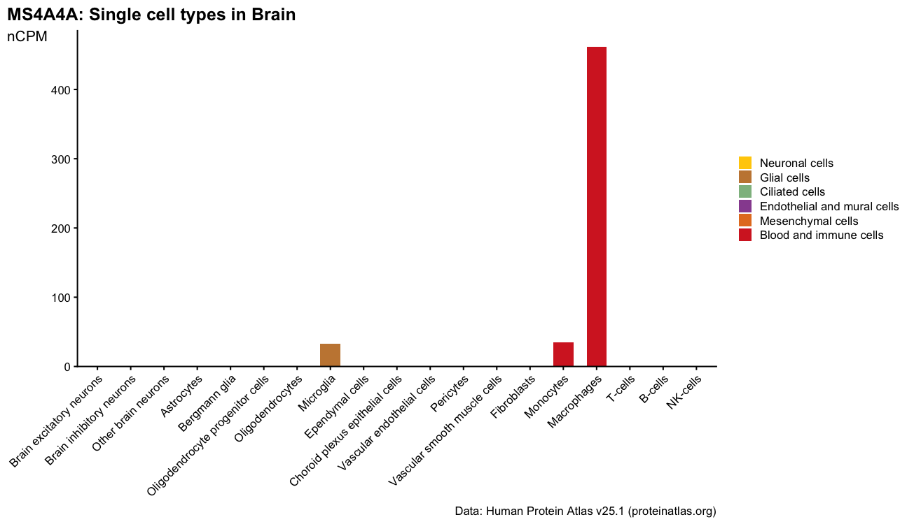
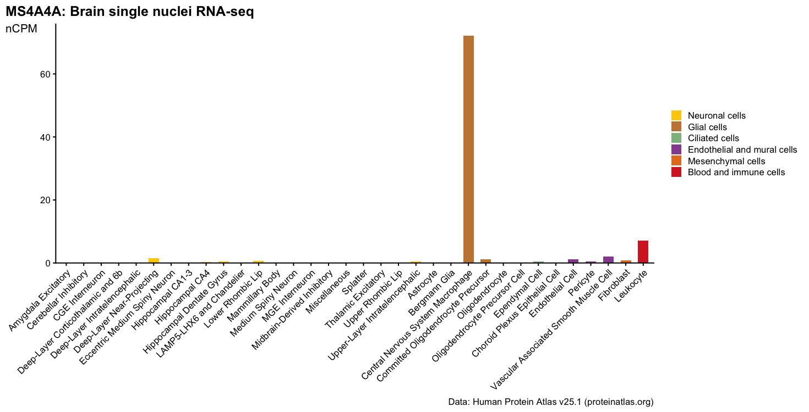
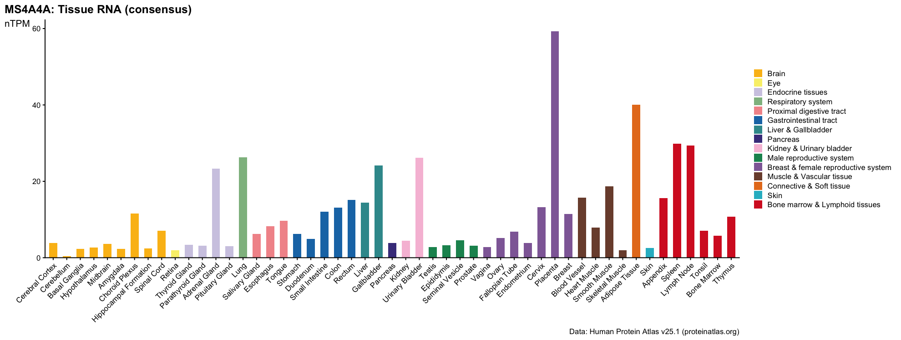

# hpa-gene-expression

Plot a gene's RNA expression from the [Human Protein Atlas](https://www.proteinatlas.org) (HPA v25.1) in the HPA website's chart layout, with R/ggplot2. In Claude Code, `/hpa-gene-expression <GENE>` walks through the options (dataset → tissue) and draws the figure.

## Requirements

- R ≥ 4.3 with `ggplot2`, `jsonlite`, `patchwork`; `grep`, `unzip`
- ~2 GB disk for HPA downloads (fetched into `data/` on first use)

## Usage

```bash
S=.claude/skills/hpa-gene-expression/scripts
Rscript $S/hpa_plot.R --gene=<GENE> --dataset=single_cell                    # 53 cell type groups + tissue dot matrix
Rscript $S/hpa_plot.R --gene=<GENE> --dataset=single_cell --tissue=<tissue>  # cell types within one tissue
Rscript $S/hpa_plot.R --gene=<GENE> --dataset=brain_sn                       # brain single nuclei cluster types
Rscript $S/hpa_plot.R --gene=<GENE> --dataset=tissue                         # 51 tissues (bulk RNA consensus)
```

Gene symbol or Ensembl ID. Outputs: `figures/<GENE>_<dataset>[_<tissue>].{pdf,png,tsv}`. Add `--source=web` (single cell only) to read the website's chart data instead of the downloads.

## Demo: MS4A4A

**Single cell overview** (`--dataset=single_cell`): bars = highest nCPM per cell type group; dots = groups detected (≥ 1 nCPM) in each tissue, sized by nCPM.


**One tissue** (`--dataset=single_cell --tissue=brain`): macrophages 461.8 nCPM, far above microglia 32.4.



**Brain single nuclei** (`--dataset=brain_sn`): central nervous system macrophage 72.2 nCPM.



**Tissues** (`--dataset=tissue`): highest in placenta (59.3 nTPM).



## How the numbers are computed

| Plot | Source | Value |
|---|---|---|
| single_cell overview, bars | `rna_single_cell_type.tsv` | max nCPM over the cell types in each of 53 HPA groups |
| single_cell overview, dots / one tissue | `rna_single_cell_cluster.tsv` | cell-count-weighted mean of cluster nCPM; dot colored if ≥ 1 nCPM |
| subtitle | `proteinatlas.tsv` | RNA single cell type group specificity |
| brain_sn | `rna_single_nuclei_cluster_type.tsv` | nCPM |
| tissue | `rna_tissue_consensus.tsv` | nTPM |

The downloads lack display metadata (group membership, order, colors, cluster cell counts). These gene-independent tables (`*.tsv` here) are scraped once from HPA pages by `scripts/build_tables.R`.

**Validation.** `scripts/check_sources.R` recomputes 10 genes (overview + 5 tissues each, 4,700 values) and compares them with the chart data in HPA's own gene pages: 95.8% identical, 100% within 0.1 nCPM; 10 of 3,271 tissue × group dots differ in color (all at ~1 nCPM). The residual comes from the cluster TSV being rounded to one decimal.

## Updating to a new HPA release

```bash
rm -rf data/                     # and set HPA_VERSION in scripts/hpa_plot.R
Rscript $S/build_tables.R        # rebuild display tables
Rscript $S/check_sources.R       # must print OK (~10 min)
```

## Citation

Data from the Human Protein Atlas, [CC BY-SA 4.0](https://www.proteinatlas.org/about/licence); figure captions carry the citation.
