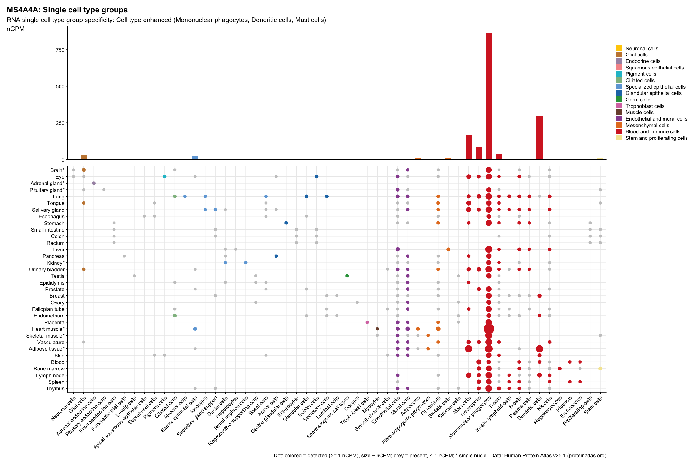

# bioinformatic-tool

A personal toolkit of bioinformatics workflows for [Claude Code](https://claude.com/claude-code): skills, agents and harness configuration that let Claude fetch public omics data, analyze it, and produce publication-style figures (mostly R/ggplot2). Each tool also runs on its own from the command line.

## Tools

| Tool | Type | What it does |
|---|---|---|
| [`hpa-gene-expression`](.claude/skills/hpa-gene-expression/) | Skill | Human Protein Atlas RNA expression (single cell, brain single nuclei, tissues) plotted in the HPA website's layout |

Each tool's folder has its own README (usage, data sources, validation).

### Demo: `hpa-gene-expression`

In Claude Code, `/hpa-gene-expression MS4A4A` asks which dataset and tissue to show, then draws the figure. The same plot from the command line:

```bash
Rscript .claude/skills/hpa-gene-expression/scripts/hpa_plot.R --gene=MS4A4A --dataset=single_cell
```



## Layout

```
.claude/
├── settings.json        # project permissions/hooks shared by all tools
├── skills/<name>/       # one folder per skill: SKILL.md, README.md, scripts/, small reference tables
└── agents/<name>.md     # subagents (when added)
CLAUDE.md                # conventions Claude follows in this repo
data/                    # downloaded datasets, re-creatable, gitignored
figures/                 # outputs, gitignored
```

## Getting started

```bash
git clone https://github.com/yous0614/bioinformatic-tool.git
cd bioinformatic-tool
claude                   # project skills load only when Claude Code starts in this folder
```

Then type `/` in Claude Code to see the available skills. Requirements per tool are listed in its README; the common base is R ≥ 4.3 (`ggplot2`, `jsonlite`, `patchwork`) plus standard Unix tools (`grep`, `unzip`, `curl`).

## Adding a tool

- **Skill**: `.claude/skills/<name>/SKILL.md` (what Claude does) + `README.md` (for humans) + `scripts/`. Scripts must run from any working directory and write to `data/` / `figures/` at the repo root.
- **Agent**: `.claude/agents/<name>.md`.
- **Harness** (permissions, hooks): `.claude/settings.json`; keep entries scoped to the tool that needs them.
- Large or re-downloadable data never goes in git; commit only small reference tables together with the script that rebuilds them.
- Leave one runnable check per tool and list it in `CLAUDE.md`. Add a row to the table above.

## Data licenses

Tools fetch data from public resources under their own terms; each tool's README states its source and citation. Human Protein Atlas data is [CC BY-SA 4.0](https://www.proteinatlas.org/about/licence).
